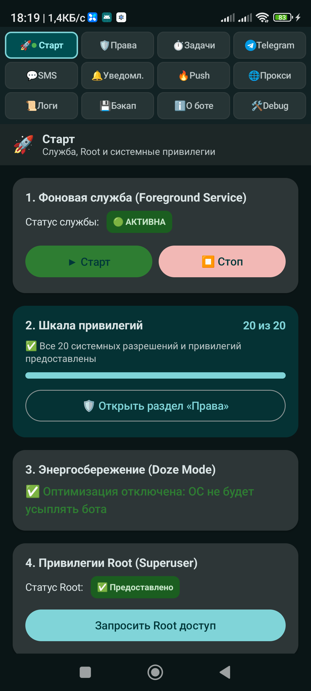
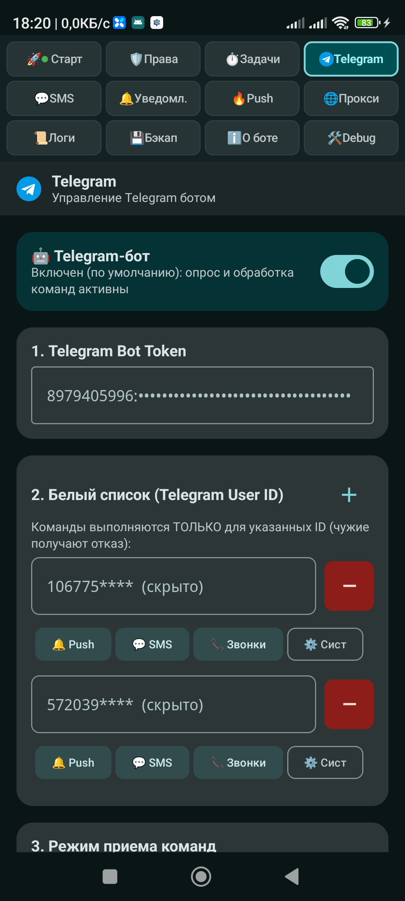
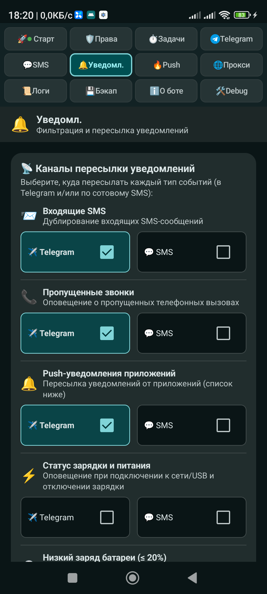
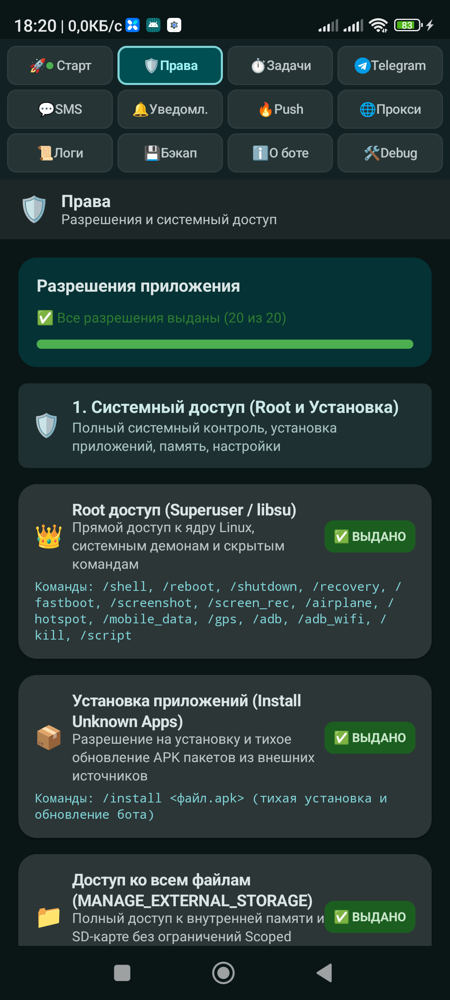
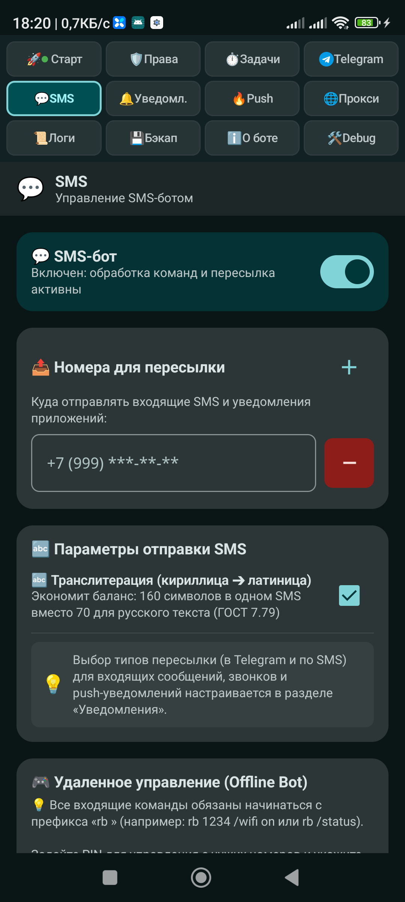
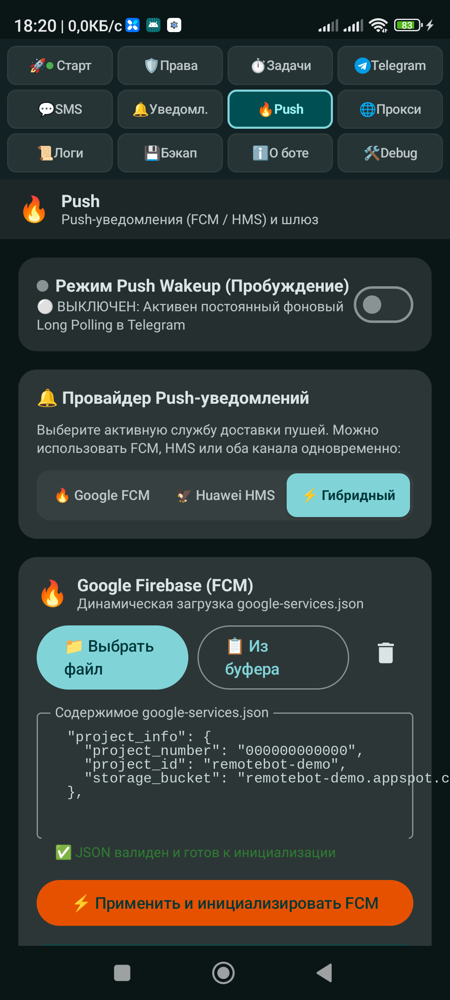
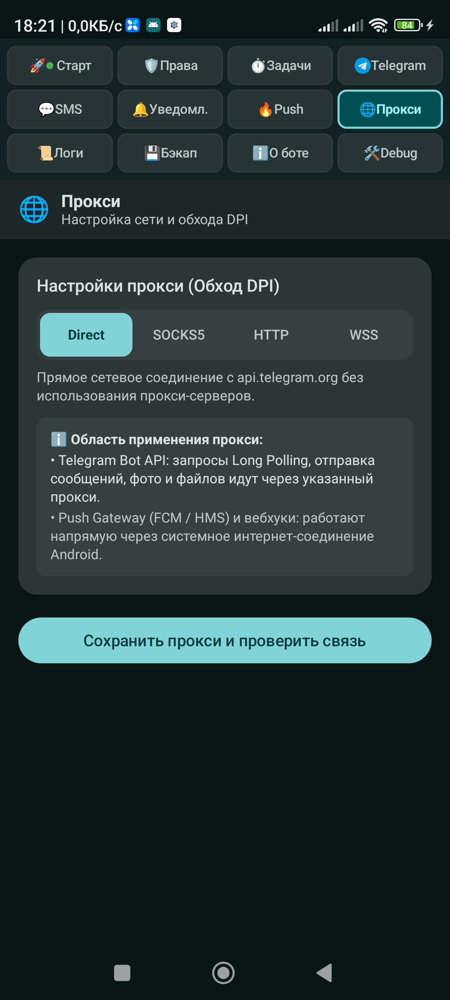
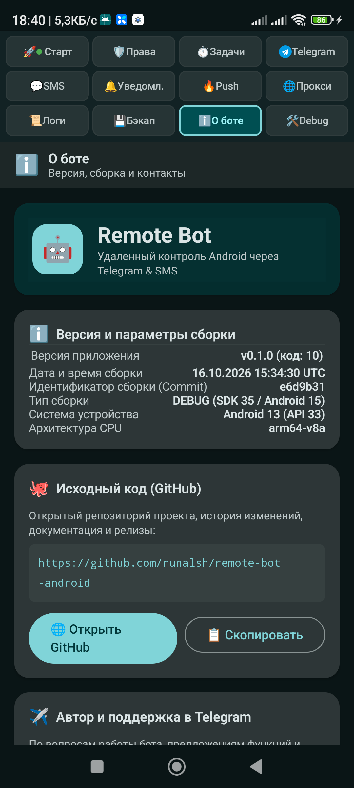
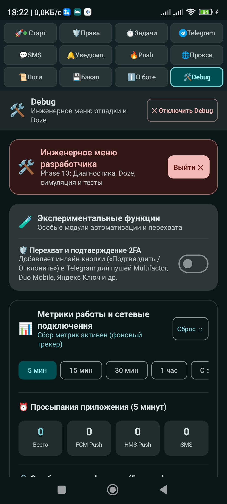

# Remote Bot for Telegram

<p align="center">
  <strong>Autonomous, self-hosted Android remote administration, surveillance, and automation server powered by Telegram & SMS.</strong>
</p>

<p align="center">
  <a href="README_RU.md">🇷🇺 Читать на русском языке (Russian version)</a>
</p>

<p align="center">
  
  
  
  
  
  
</p>

---

## 📖 Table of Contents

- [Overview & Philosophy](#-overview--philosophy)
- [Application Screenshots](#-application-screenshots)
- [Key Features & Capabilities](#-key-features--capabilities)
- [Project Documentation (`docs/`)](#-project-documentation-docs)
- [Server Infrastructure & Docker (`server/`)](#-server-infrastructure--docker-server)
- [Building from Source](#-building-from-source)
- [Makefile Commands Cheatsheet](#-makefile-commands-cheatsheet)
- [CI/CD & Quality Gates](#-cicd--quality-gates)
- [License](#-license)

---

## 🌟 Overview & Philosophy

**Remote Bot for Telegram** transforms any Android device (smartphone, tablet, emulator, or TV box) into a private, self-hosted remote management and surveillance node. Interact with your device through a personal Telegram chat or fallback SMS commands when offline.

### Core Principles:
- 🔒 **Zero Telemetry & Absolute Privacy**: Connects directly to `api.telegram.org` or your private Bot API instance. No third-party servers, no analytics, no proprietary cloud databases.
- ⚡ **Zero-Drain Dual Push Architecture**: Uses Google Firebase (FCM) and Huawei Mobile Services (HMS) data messages to wake the bot from Android Doze Mode only when an update arrives, saving battery life.
- 📶 **Offline Resilience**: Automatically falls back to SMS commands and sends SMS notifications if mobile data/Wi-Fi is disconnected.
- 🛡 **Security by Design**: Multi-user whitelisting, SMS PIN verification for destructive operations, and encrypted credential storage backed by Android Keystore.
- 📱 **Modern Android Standards**: Built for Android 14 & 15 (Target SDK 35) using Foreground Service types, Scoped Storage, CameraX, Room, and Jetpack Compose Material 3 with NavigationRail.

---

## 📱 Application Screenshots

| 🚀 Foreground Service & Status | 🤖 Telegram Configuration | 🔔 Notification Hub & Mirroring |
| :---: | :---: | :---: |
|  |  |  |

<details>
<summary><b>📸 View More Screenshots (Permissions, SMS Gateway, Push Wakeup, Proxy, About, Debug)</b></summary>
<br />

| 🛡️ 20 System Permissions | 💬 SMS Remote Gateway | 🔥 Dual Push Wakeup (FCM/HMS) |
| :---: | :---: | :---: |
|  |  |  |

| 🌐 Proxy & DPI Bypass | ℹ️ About & Version Information | 🛠️ Developer Diagnostics |
| :---: | :---: | :---: |
|  |  |  |

</details>

---

## ⚡ Key Features & Capabilities

### 1. 🤖 Telegram & SMS Dual Control Engine
- **54+ Remote Commands**: Full device inspection, system controls, media streaming, notifications, telephony, files, location, and shell execution.
- **Connection Modes**: High-efficiency Long Polling or Webhook Push Wakeup.
- **SMS Remote Bot**: Control the device offline via encrypted/prefixed SMS commands (`rb status`, `rb photo`, `rb location`, etc.).
- **Anti-Blocking & DPI Bypass**: Built-in support for custom API endpoints, Direct/SOCKS5 proxies with credentials, and Cloudflare Reverse Proxy.

### 2. 🔔 Notification Mirroring & Interactive Replies
- **Notification Mirroring**: Forwards incoming notifications from any installed Android app directly to your Telegram chat.
- **Filter Engine**: 10 customizable filtering rules (app selection, substring matching, regex patterns, case sensitivity, inversion).
- **Anti-Echo & Dedup Window**: Suppresses duplicate notifications within configurable time windows and ignores notifications generated by the bot itself.
- **Remote Quick Reply (`/answer <id> <text>`)**: Reply to incoming notifications (Telegram, WhatsApp, Signal, SMS) directly from Telegram chat using Android `RemoteInput` API.

### 3. 🔋 Dual Push Wakeup (Google FCM + Huawei HMS)
- **Zero Background Drain**: The bot does not keep an active TCP socket open in the background. Instead, it wakes up upon receiving high-priority silent data push messages.
- **Dual Vendor Gateway**: Supports both Google Play Services (`google-services.json`) and Huawei Mobile Services (`agconnect-services.json`) simultaneously.
- **Multi-Server Pool**: Automatic health-checking and failover between configured push server endpoints.

### 4. 📞 Telephony & SMS
- **Call Monitoring**: Live notifications for incoming, outgoing, and missed calls with contact names and numbers.
- **Remote Calling (`/call <number>`)**: Place phone calls remotely.
- **Remote SMS (`/sms <number> <text>`)**: Send SMS messages remotely with multi-SIM slot selection and automatic transliteration option.
- **USSD Execution (`/ussd <code>`)**: Check mobile balances and manage operator services.

### 5. 📸 Camera, Audio & Screen Surveillance
- **CameraX Silent Capture (`/photo [front|back] [flash]`)**: Background photography without preview windows or shutter sounds.
- **Silent Video Recording (`/video <duration> [front|back]`)**: Record MP4 video clips silently in the background.
- **Audio Recording (`/record <duration>`)**: Record ambient sound and receive it as an audio message or voice note.
- **Screen Capture & Recording (`/screenshot`, `/screen <duration>`)**: Real-time display capture via Android MediaProjection API.

### 6. 📍 Hybrid Geolocation Tracking
- **Multi-Provider Support**: Fused Location Provider (Google Play Services), Huawei Location Kit, and AOSP GNSS GPS/Network fallback.
- **Continuous Tracking (`/track_location <interval> <duration>`)**: Periodic location updates directly to your chat with Google Maps and OpenStreetMap links.

### 7. 🛡 Security, Permissions & Administration
- **User Whitelist**: Restrict bot execution strictly to authorized Telegram User IDs.
- **Granular Subscriptions (`/events`)**: Customize notification categories (Push, SMS, Calls, System) per whitelisted user via interactive inline keyboard buttons.
- **Destructive Command Protection**: Require SMS PIN or inline confirmation for `/reboot`, `/wipe`, `/shell`, and settings resets.
- **Encrypted Storage**: Bot tokens, proxy passwords, and encryption keys are encrypted using Google Tink / `EncryptedSharedPreferences`.

### 8. ⚙️ Root & Shell Engine
- **Libsu Integration**: Execute root commands asynchronously with non-blocking I/O (`/shell <command>`).
- **Shizuku API Support**: Execute elevated system commands without requiring traditional root access.
- **App Management (`/apps`, `/app_info`)**: List installed packages, view permissions, launch apps, or pull APKs remotely.

---

## 📚 Project Documentation (`docs/`)

The [`docs/`](docs/) directory contains comprehensive guides and configuration templates for setting up third-party services and security keys:

| File | Purpose | Why It Is Needed |
| :--- | :--- | :--- |
| [**`FIREBASE_SETUP.md`**](docs/FIREBASE_SETUP.md) | **Google Firebase FCM Setup Guide** | Detailed walkthrough for creating a Google Firebase project, generating credentials, and downloading `google-services.json` to enable zero-drain FCM Push Wakeup. |
| [**`HMS_SETUP.md`**](docs/HMS_SETUP.md) | **Huawei HMS Push Kit Setup Guide** | Instructions for setting up Huawei AppGallery Connect, enabling Push Kit, registering Release (`remotebot`) and Debug SHA-256 certificate fingerprints, and downloading `agconnect-services.json`. |
| [**`CLOUDFLARE_WORKER_SETUP.md`**](docs/CLOUDFLARE_WORKER_SETUP.md) | **Cloudflare Workers Push Gateway** | Guide to deploying a free, serverless push gateway script on Cloudflare Workers so Telegram webhooks wake up your device without running a dedicated VPS. |
| [**`CLOUDFLARE_TELEGRAM_REVERSE_PROXY.md`**](docs/CLOUDFLARE_TELEGRAM_REVERSE_PROXY.md) | **Cloudflare Reverse Proxy for Telegram** | Step-by-step setup of an HTTPS reverse proxy for `api.telegram.org` on Cloudflare Workers to bypass DPI restrictions and ISP censorship. |
| [**`google-services.json.example`**](docs/google-services.json.example) | **Firebase Config Template** | Reference structure for `app/google-services.json` required by the Google Services Gradle plugin. |
| [**`agconnect-services.json.example`**](docs/agconnect-services.json.example) | **Huawei AGC Config Template** | Reference structure for `app/agconnect-services.json` required by the Huawei AGConnect Gradle plugin. |
| [**`keystore.properties.example`**](docs/keystore.properties.example) | **Release Signing Keystore Template** | Template for `keystore.properties` to specify your production keystore path, alias, and passwords for automated Release APK signing. |
| [**`.env.example`**](docs/.env.example) | **Environment Variables Template** | Configuration template for standalone server gateways (FCM service account credentials, Huawei App ID/Secret, and webhook secret keys). |

---

## 🖥 Server Infrastructure & Docker (`server/`)

The repository includes lightweight server gateways located in [`server/`](server/) to route Telegram webhook updates to FCM/HMS push notifications, as well as reverse proxies for `api.telegram.org`:

### 1. Push Gateways (`server/serverpush/`)
Translates Telegram webhook `POST` updates into Google FCM and Huawei HMS push notifications:
- **Go (`go/`)**: Ultra-lightweight `FROM scratch` binary (~10 MB RAM, self-contained healthchecks).
- **Python (`python/`)**: Python 3.14 Alpine microservice based on standard HTTP server.
- **OpenResty (`nginx/`)**: High-performance Lua gateway based on OpenResty Alpine.
- **Cloudflare Worker (`cloudflare-worker/`)**: Serverless JavaScript implementation for edge deployment.

### 2. Telegram API Reverse Proxies (`server/serverapi/`)
Reverse proxies for `api.telegram.org` with TLS support:
- **Go (`go/`)**: High-concurrency `FROM scratch` reverse proxy.
- **Python (`python/`)**: Minimal Python 3.14 proxy.
- **Nginx (`nginx/`)**: High-throughput Nginx 1.30.6 Alpine proxy.
- **Cloudflare Worker (`cloudflare-worker/`)**: Edge reverse proxy script.

---

## 🚀 Building from Source

### Prerequisites:
- **JDK 17** (Temurin recommended)
- **Android SDK 35** (Build-tools `35.0.0+`, Platform SDK 35)
- **Docker** (optional, for server gateways)

### 1. Clone & Configure
```bash
git clone https://github.com/runalsh/remote-bot-android.git
cd remote-bot-android

# (Optional) Add your Push credentials
cp docs/google-services.json.example app/google-services.json
cp docs/agconnect-services.json.example app/agconnect-services.json

# (Optional) Configure production signing key
cp docs/keystore.properties.example keystore.properties
```

### 2. Build APKs
```bash
# Build Debug APK (signed with debug key)
make build-apk
# Output: app/build/outputs/apk/debug/app-debug.apk

# Build Production Release APK (signed with release.jks or fallback debug key)
make build-release
# Output: app/build/outputs/apk/release/app-release.apk
```

### 3. Install & Run on Device
```bash
# Install and launch on connected ADB device
make install

# Clean reinstall (uninstall -> install -> launch)
make reinstall
```

---

## 🛠 Makefile Commands Cheatsheet

| Target | Description |
| :--- | :--- |
| `make check` | Full quality gate: runs compilation (`check-compile`), linters (`lint`), and all tests (`test`). |
| `make check-compile` | Fast compilation check of all Kotlin modules (`compileDebugKotlin`). |
| `make check-ui` | Fast compilation check of the UI module (`:app:compileDebugKotlin`). |
| `make lint` | Runs all static analysis tools without modifying code (`ktlintCheck`, `detekt`, `lintDebug`). |
| `make lint-fix` | Automatically formats Kotlin code using KtLint (`ktlintFormat`). |
| `make test` | Runs all test suites (Android Domain + Go + Python + JS server gateways). |
| `make test-coverage` | Runs unit tests and generates Jacoco code coverage HTML/XML reports. |
| `make test-android` | Runs Kotlin/Android unit tests (`:domain:test`). |
| `make test-server` | Runs unit tests for all Push Gateway and API Proxy servers. |
| `make build-apk` | Assembles Android Debug APK (`./gradlew assembleDebug`). |
| `make build-release` | Assembles signed Android Release APK (`./gradlew assembleRelease`). |
| `make docker-build-all`| Builds all 8 Docker images for `linux/amd64` (Go, Python, Nginx/OpenResty, NPX). |
| `make docker-compose-build`| Builds all Docker Compose profiles (`go`, `python`, `nginx`, `npx`). |
| `make clean` | Cleans build artifacts and Gradle cache. |

---

## 🧪 CI/CD & Quality Gates

The project uses automated GitHub Actions workflows:

1. **Continuous Integration ([`.github/workflows/ci.yml`](.github/workflows/ci.yml))**:
   - Validates Gradle Wrapper checksum.
   - Runs static analysis: KtLint, Detekt, and Android Lint.
   - Executes Android & JVM unit tests and generates Jacoco coverage reports.
   - Tests all 6 server gateway implementations (Go, Python, Cloudflare Worker).
   - Assembles and signs Debug and Release APKs.
2. **Docker Multi-Server Publish ([`.github/workflows/docker.yml`](.github/workflows/docker.yml))**:
   - Builds and publishes all 8 server gateway images targeted strictly for `linux/amd64`.
3. **Automated GitHub Releases ([`.github/workflows/release.yml`](.github/workflows/release.yml))**:
   - Triggers on git tags `v*` (e.g. `v0.1.0`).
   - Builds and signs:
     - `remote-bot-android_${TAG}.apk` (production signature via `release.jks`).
     - `remote-bot-android_${TAG}_testkey.apk` (debug signature).
   - Generates SHA-256 checksums (`*.sha256`) for both APKs.
   - Publishes an official GitHub Release with release notes and attached APKs.

---

## ⚠️ Disclaimer of Liability

This software is developed and provided strictly for educational, personal remote administration, and authorized device management purposes.

- The author and contributors are **not responsible** for any misuse, data loss, hardware damage, legal consequences, unauthorized surveillance, or any other direct or indirect damages resulting from the installation or usage of this application.
- The user bears sole responsibility for ensuring compliance with all applicable local, federal, and international laws, privacy rights, and telecommunication regulations in their jurisdiction.
- Installing and running this software is done entirely at your own risk.

---

## 📄 License

```text
Copyright 2026 runalsh (https://github.com/runalsh/remote-bot-android)

Licensed under the Apache License, Version 2.0 (the "License");
you may not use this file except in compliance with the License.
You may obtain a copy of the License at

    http://www.apache.org/licenses/LICENSE-2.0

Unless required by applicable law or agreed to in writing, software
distributed under the License is distributed on an "AS IS" BASIS,
WITHOUT WARRANTIES OR CONDITIONS OF ANY KIND, either express or implied.
See the License for the specific language governing permissions and
limitations under the License.
```

See the full [LICENSE](LICENSE) file for terms and conditions.
